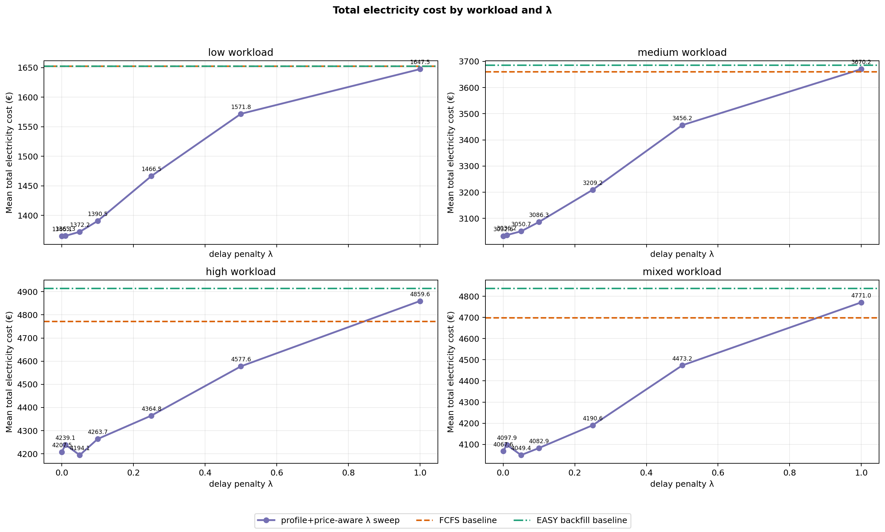
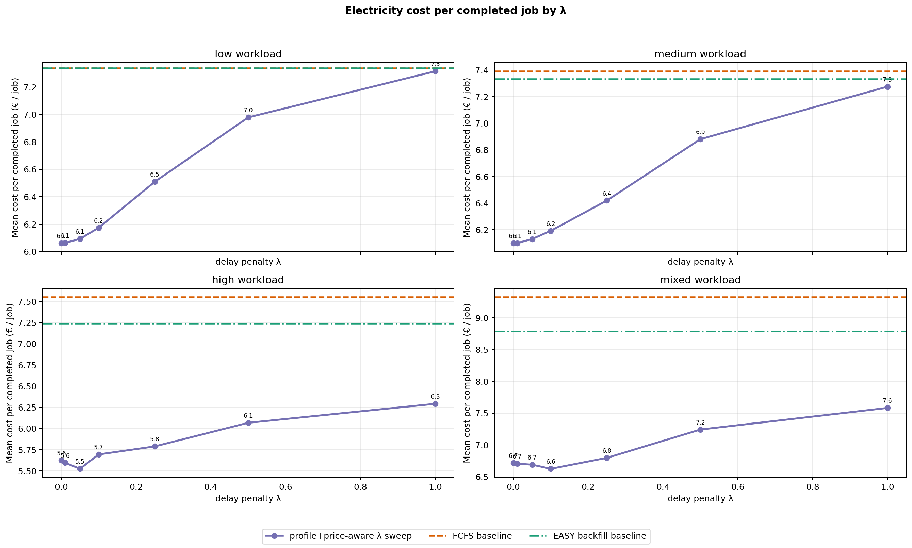
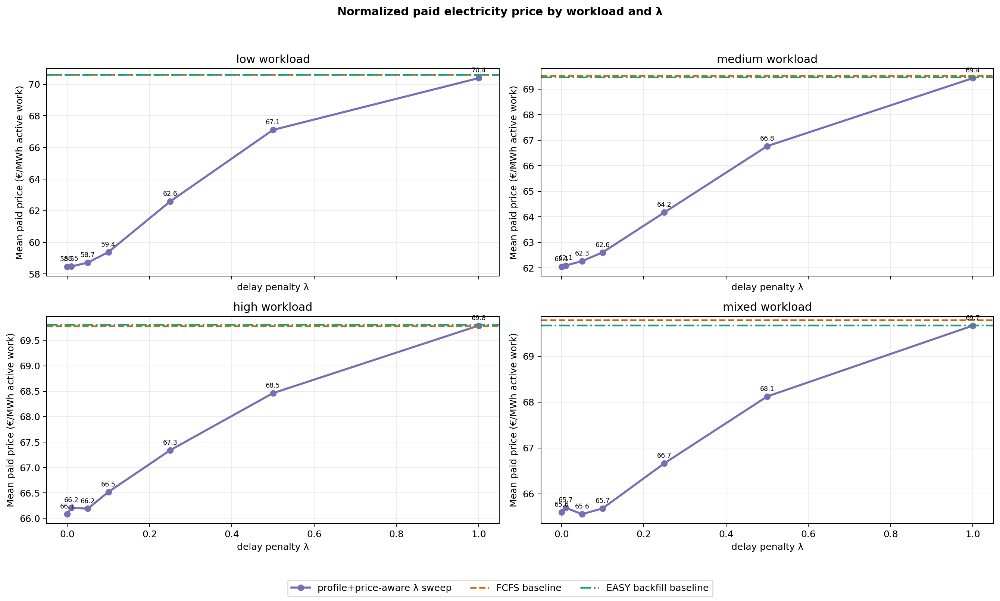
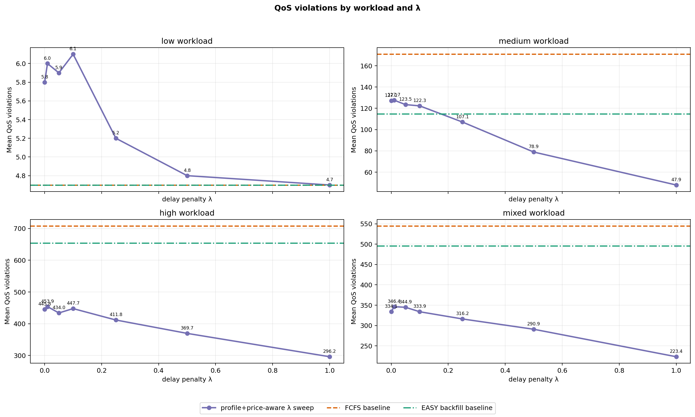
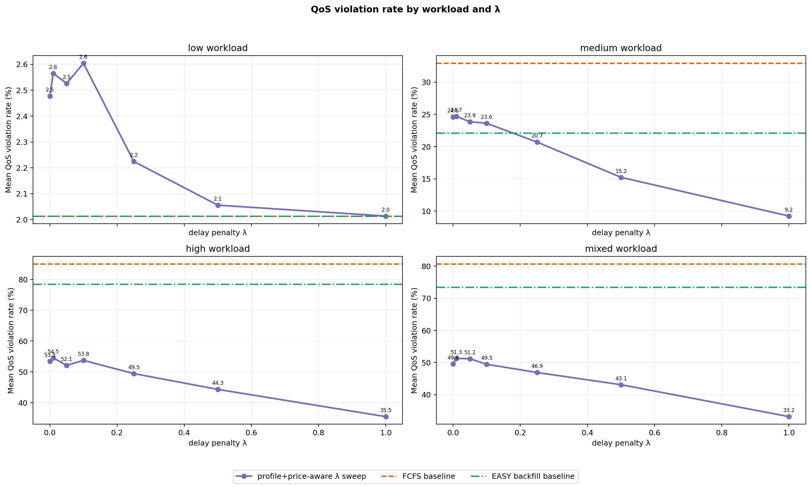
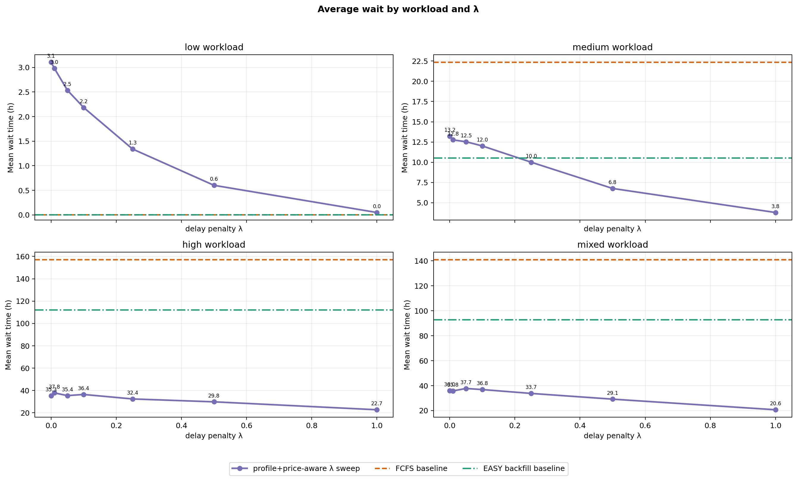
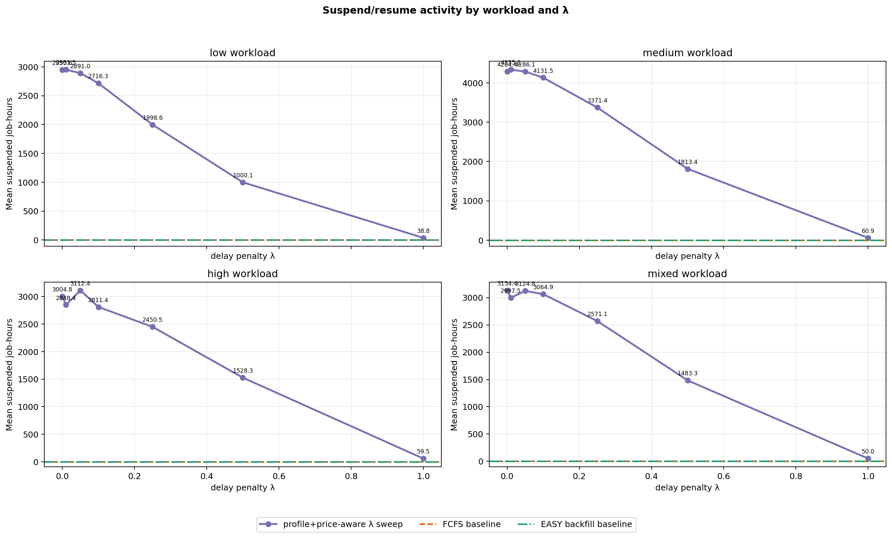
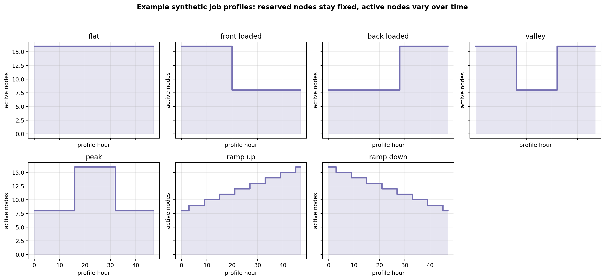

# Current Policy Evaluation — FCFS, EASY Backfilling, and Profile+Price-Aware λ Sweep

This is the current cleaned Bachelor-thesis simulator result artifact. It keeps only the focused scheduler comparison:

1. `fcfs` baseline.
2. `easy_backfill` baseline.
3. `price_aware_preemptive`, the current profile+price-aware pause/resume policy, evaluated over several λ values.

The older non-preemptive delayed-start `price_aware` scheduler model is intentionally not part of this report.

## Run configuration

- price_source: `data/prices/smard_de_lu_2024_hourly.csv`
- price_offset_h: `0`
- arrival/simulation horizon: `1440` h (`60.0` days)
- loaded price horizon: `1440` h
- capacity_nodes: `64`
- power_kw_per_node: `1`
- seeds: `42, 43, 44, 45, 46, 47, 48, 49, 50, 51`
- lambda_values: `0, 0.01, 0.05, 0.1, 0.25, 0.5, 1`
- parallel_workers: `30`
- qos_violation_penalty_eur for λ ranking: `1000`
- maximum generated job duration observed: `336` h

## Workload scale

- Mean jobs per low workload: `230.0`.
- Mean jobs per medium workload: `515.1`.
- Mean jobs per high workload: `831.3`.
- Mean jobs per mixed workload: `673.7`.
- Runtime classes: `short_debug` = 1–6 h, `medium` = 6–48 h, `long` = 48–336 h.

## Current policy model

Jobs reserve their requested node count until completion. The hourly `JobProfile` controls how many of those reserved nodes are active and therefore how much electricity cost is incurred. In the current preemptive policy, checkpointable jobs can be paused/resumed at hourly boundaries, but paused jobs keep their reserved nodes.

The λ parameter is an urgency term in the hourly run/skip decision. Lower λ lets the policy wait more aggressively for cheap hours; higher λ makes it less willing to delay when the expected saving is small.

## Best λ by QoS-penalized objective

- low: λ=`1.0`; cost=1647.4592 €, cost/job=7.3164 €, paid_price=70.3855 €/MWh, QoS=4.7, avg_wait=0.048 h, penalized=6347.4592 €.
- medium: λ=`1.0`; cost=3670.1521 €, cost/job=7.2755 €, paid_price=69.4252 €/MWh, QoS=47.9, avg_wait=3.7877 h, penalized=51570.1522 €.
- high: λ=`1.0`; cost=4859.6472 €, cost/job=6.2923 €, paid_price=69.7906 €/MWh, QoS=296.2, avg_wait=22.7285 h, penalized=301059.6472 €.
- mixed: λ=`1.0`; cost=4771.0277 €, cost/job=7.5827 €, paid_price=69.6641 €/MWh, QoS=223.4, avg_wait=20.6473 h, penalized=228171.0277 €.

## Plots

## Summary table

| Load | Variant | λ | Runs | Completed mean | Cost mean € | Cost/job € | QoS mean | QoS rate % | Paid €/MWh | Avg wait h | Reserved util | Suspended h | Penalized € |
|---|---|---:|---:|---:|---:|---:|---:|---:|---:|---:|---:|---:|---:|
| low | fcfs | baseline | 10 | 225.3 | 1652.458 | 7.3387 | 4.7 | 2.0137 | 70.6008 | 0.0022 | 0.3215 | 0.0 | 6352.458 |
| low | easy_backfill | baseline | 10 | 225.3 | 1652.458 | 7.3387 | 4.7 | 2.0137 | 70.6008 | 0.0022 | 0.3215 | 0.0 | 6352.458 |
| low | preemptive_profile_price_aware_lambda_0 | 0.0 | 10 | 225.2 | 1365.0685 | 6.0616 | 5.8 | 2.477 | 58.4626 | 3.1059 | 0.478 | 2950.6 | 7165.0685 |
| low | preemptive_profile_price_aware_lambda_0.01 | 0.01 | 10 | 225.2 | 1365.3162 | 6.0627 | 6.0 | 2.5651 | 58.4733 | 2.9823 | 0.4785 | 2951.5 | 7365.3162 |
| low | preemptive_profile_price_aware_lambda_0.05 | 0.05 | 10 | 225.2 | 1372.1837 | 6.0929 | 5.9 | 2.526 | 58.7184 | 2.5361 | 0.4769 | 2891.0 | 7272.1837 |
| low | preemptive_profile_price_aware_lambda_0.1 | 0.1 | 10 | 225.2 | 1390.528 | 6.1736 | 6.1 | 2.6039 | 59.384 | 2.1838 | 0.468 | 2716.3 | 7490.528 |
| low | preemptive_profile_price_aware_lambda_0.25 | 0.25 | 10 | 225.3 | 1466.5091 | 6.5096 | 5.2 | 2.2245 | 62.5832 | 1.3401 | 0.428 | 1998.6 | 6666.5091 |
| low | preemptive_profile_price_aware_lambda_0.5 | 0.5 | 10 | 225.3 | 1571.8282 | 6.9795 | 4.8 | 2.0558 | 67.1102 | 0.6013 | 0.37 | 1000.1 | 6371.8282 |
| low | preemptive_profile_price_aware_lambda_1 | 1.0 | 10 | 225.3 | 1647.4592 | 7.3164 | 4.7 | 2.0137 | 70.3855 | 0.048 | 0.3232 | 38.8 | 6347.4592 |
| medium | fcfs | baseline | 10 | 495.4 | 3659.9082 | 7.3911 | 170.9 | 32.9179 | 69.5126 | 22.3546 | 0.7291 | 0.0 | 174559.9082 |
| medium | easy_backfill | baseline | 10 | 502.3 | 3685.7442 | 7.3331 | 114.8 | 22.1188 | 69.4548 | 10.5241 | 0.7349 | 0.0 | 118485.7442 |
| medium | preemptive_profile_price_aware_lambda_0 | 0.0 | 10 | 497.2 | 3032.6316 | 6.0999 | 127.2 | 24.5798 | 62.0527 | 13.2334 | 0.8665 | 4284.4 | 130232.6316 |
| medium | preemptive_profile_price_aware_lambda_0.01 | 0.01 | 10 | 497.7 | 3036.2001 | 6.0996 | 127.7 | 24.6761 | 62.0951 | 12.7612 | 0.8673 | 4335.1 | 130736.2001 |
| medium | preemptive_profile_price_aware_lambda_0.05 | 0.05 | 10 | 497.5 | 3050.6834 | 6.1305 | 123.5 | 23.8535 | 62.2692 | 12.5312 | 0.8672 | 4286.1 | 126550.6834 |
| medium | preemptive_profile_price_aware_lambda_0.1 | 0.1 | 10 | 498.3 | 3086.282 | 6.192 | 122.3 | 23.6081 | 62.6094 | 12.0121 | 0.8657 | 4131.5 | 125386.282 |
| medium | preemptive_profile_price_aware_lambda_0.25 | 0.25 | 10 | 499.8 | 3209.2466 | 6.4198 | 107.1 | 20.6971 | 64.1739 | 10.0034 | 0.8444 | 3371.4 | 110309.2466 |
| medium | preemptive_profile_price_aware_lambda_0.5 | 0.5 | 10 | 502.2 | 3456.2039 | 6.8806 | 78.9 | 15.2327 | 66.7656 | 6.7589 | 0.7931 | 1813.4 | 82356.2039 |
| medium | preemptive_profile_price_aware_lambda_1 | 1.0 | 10 | 504.2 | 3670.1521 | 7.2755 | 47.9 | 9.2261 | 69.4252 | 3.7877 | 0.7344 | 60.9 | 51570.1522 |
| high | fcfs | baseline | 10 | 642.5 | 4772.091 | 7.554 | 708.0 | 85.0612 | 69.7831 | 157.2329 | 0.9326 | 0.0 | 712772.091 |
| high | easy_backfill | baseline | 10 | 686.7 | 4915.0529 | 7.2404 | 653.7 | 78.5165 | 69.8091 | 112.195 | 0.9598 | 0.0 | 658615.0529 |
| high | preemptive_profile_price_aware_lambda_0 | 0.0 | 10 | 752.2 | 4207.4946 | 5.6242 | 445.8 | 53.4888 | 66.0823 | 35.2779 | 0.9693 | 3004.8 | 450007.4946 |
| high | preemptive_profile_price_aware_lambda_0.01 | 0.01 | 10 | 760.2 | 4239.1218 | 5.5958 | 453.9 | 54.5418 | 66.2055 | 37.8087 | 0.9699 | 2848.4 | 458139.1218 |
| high | preemptive_profile_price_aware_lambda_0.05 | 0.05 | 10 | 761.2 | 4194.115 | 5.5249 | 434.0 | 52.1455 | 66.19 | 35.4051 | 0.9689 | 3112.4 | 438194.115 |
| high | preemptive_profile_price_aware_lambda_0.1 | 0.1 | 10 | 752.7 | 4263.6686 | 5.6944 | 447.7 | 53.7614 | 66.5188 | 36.4188 | 0.9697 | 2811.4 | 451963.6686 |
| high | preemptive_profile_price_aware_lambda_0.25 | 0.25 | 10 | 757.3 | 4364.7613 | 5.7889 | 411.8 | 49.4729 | 67.339 | 32.4057 | 0.9672 | 2450.5 | 416164.7613 |
| high | preemptive_profile_price_aware_lambda_0.5 | 0.5 | 10 | 757.5 | 4577.5825 | 6.0682 | 369.7 | 44.3481 | 68.4622 | 29.8326 | 0.9616 | 1528.3 | 374277.5825 |
| high | preemptive_profile_price_aware_lambda_1 | 1.0 | 10 | 773.5 | 4859.6472 | 6.2923 | 296.2 | 35.5234 | 69.7906 | 22.7285 | 0.9516 | 59.5 | 301059.6472 |
| mixed | fcfs | baseline | 10 | 506.3 | 4699.0596 | 9.3279 | 544.8 | 80.7214 | 69.7829 | 141.0697 | 0.9212 | 0.0 | 549499.0596 |
| mixed | easy_backfill | baseline | 10 | 552.0 | 4837.8457 | 8.789 | 495.9 | 73.5029 | 69.6698 | 92.8132 | 0.9499 | 0.0 | 500737.8457 |
| mixed | preemptive_profile_price_aware_lambda_0 | 0.0 | 10 | 607.3 | 4067.5732 | 6.7166 | 334.1 | 49.5757 | 65.6028 | 36.0227 | 0.9567 | 3134.4 | 338167.5732 |
| mixed | preemptive_profile_price_aware_lambda_0.01 | 0.01 | 10 | 612.0 | 4097.8503 | 6.7067 | 346.4 | 51.3077 | 65.6977 | 35.75 | 0.9572 | 2997.5 | 350497.8503 |
| mixed | preemptive_profile_price_aware_lambda_0.05 | 0.05 | 10 | 606.4 | 4049.4215 | 6.6911 | 344.9 | 51.2007 | 65.5588 | 37.7122 | 0.9575 | 3124.8 | 348949.4215 |
| mixed | preemptive_profile_price_aware_lambda_0.1 | 0.1 | 10 | 617.4 | 4082.8809 | 6.6266 | 333.9 | 49.4755 | 65.6838 | 36.8276 | 0.9574 | 3064.9 | 337982.8809 |
| mixed | preemptive_profile_price_aware_lambda_0.25 | 0.25 | 10 | 617.5 | 4190.55 | 6.7982 | 316.2 | 46.9143 | 66.6659 | 33.7357 | 0.9557 | 2571.1 | 320390.55 |
| mixed | preemptive_profile_price_aware_lambda_0.5 | 0.5 | 10 | 618.6 | 4473.2421 | 7.2433 | 290.9 | 43.1232 | 68.1217 | 29.1458 | 0.9503 | 1483.3 | 295373.2421 |
| mixed | preemptive_profile_price_aware_lambda_1 | 1.0 | 10 | 630.4 | 4771.0277 | 7.5827 | 223.4 | 33.1958 | 69.6641 | 20.6473 | 0.9398 | 50.0 | 228171.0277 |

## Generated files

- `REPORT.md` — this report.
- `RUNS.md` — raw run log in Markdown.
- `runs.csv` — raw per-policy, per-seed, per-load, per-λ results.
- `summary.csv` — mean metrics by workload and policy variant.
- `workloads.csv` — generated workload composition by seed/load.
- `total_cost_by_load.png`, `cost_per_job_by_load.png`, `normalized_price_by_load.png`, `qos_violations_by_load.png`, `qos_violation_rate_percent_by_load.png`, `wait_by_load.png`, `suspension_by_load.png`, `synthetic_profile_examples.png`.
