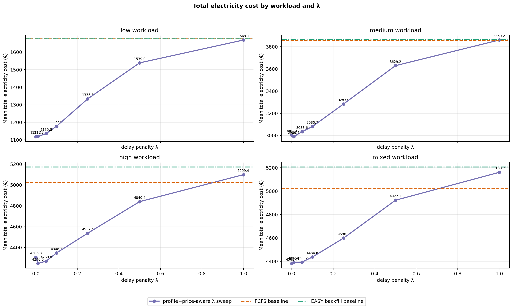
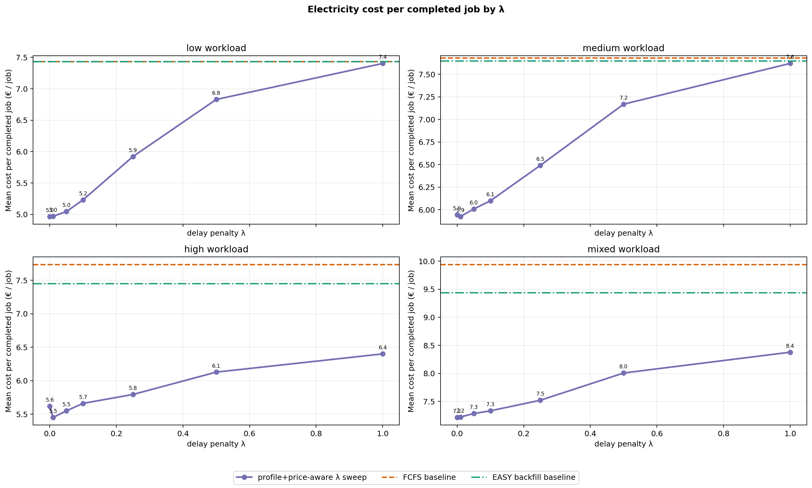
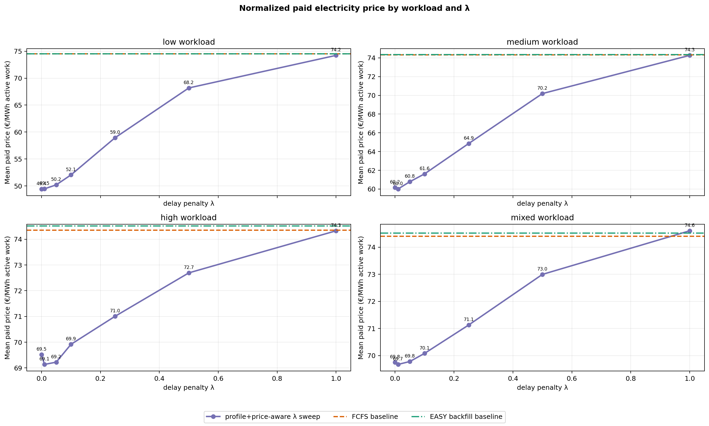
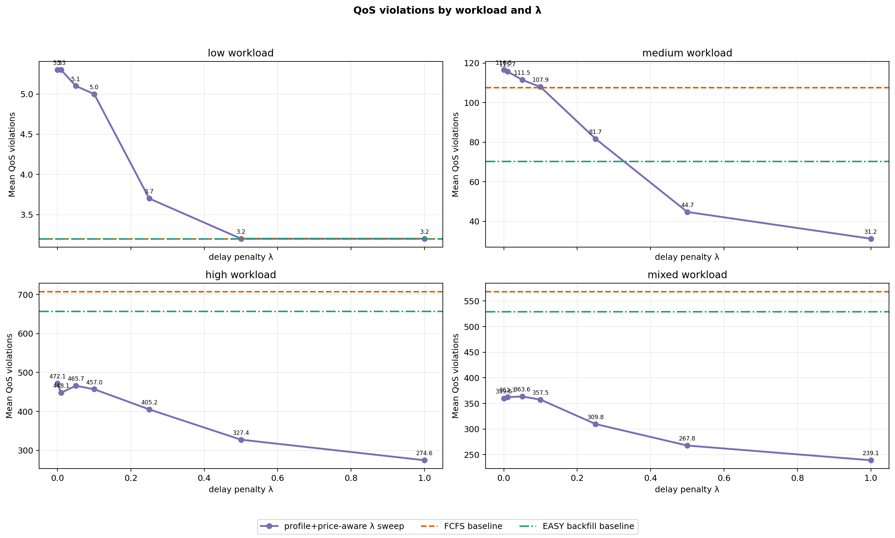
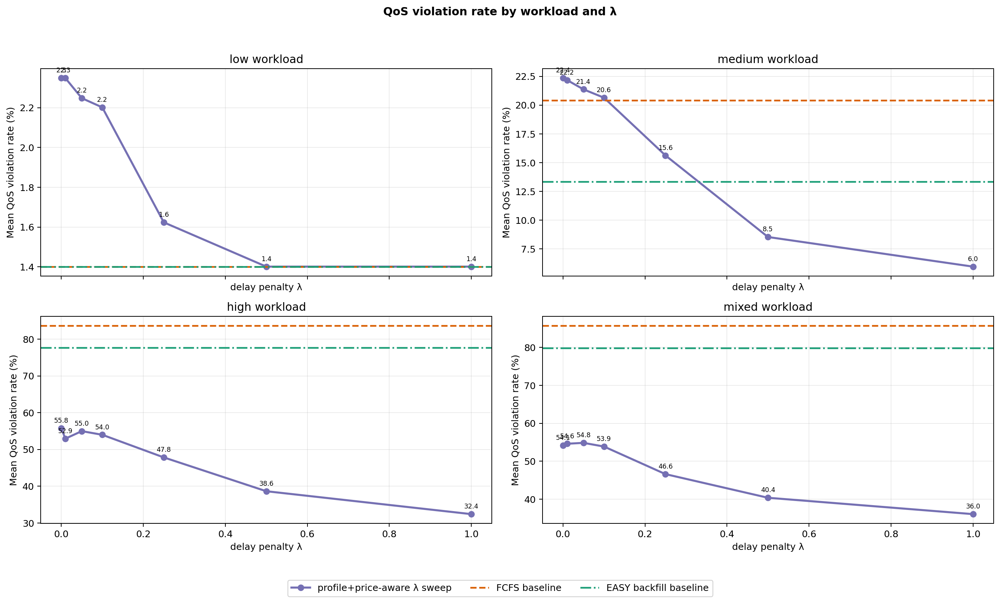
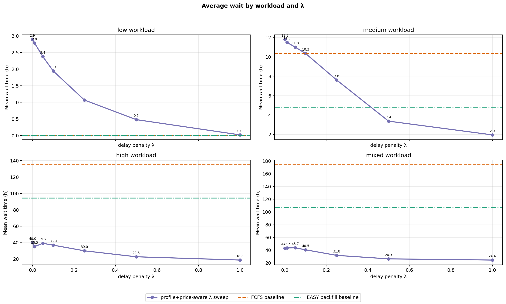
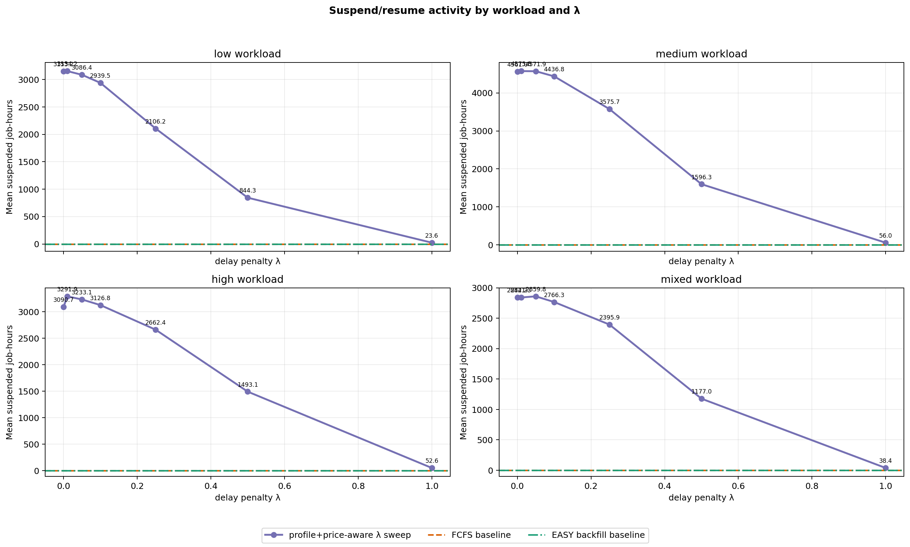

# Current Policy Evaluation — FCFS, EASY Backfilling, and Profile+Price-Aware λ Sweep

This is the current cleaned Bachelor-thesis simulator result artifact. It keeps only the focused scheduler comparison:

1. `fcfs` baseline.
2. `easy_backfill` baseline.
3. `price_aware_preemptive`, the current profile+price-aware pause/resume policy, evaluated over several λ values.

The older non-preemptive delayed-start `price_aware` scheduler model is intentionally not part of this report.

## Run configuration

- price_source: `data/prices/smard_de_lu_2024_hourly.csv`
- price_offset_h: `4368`
- arrival/simulation horizon: `1440` h (`60.0` days)
- loaded price horizon: `1440` h
- capacity_nodes: `64`
- power_kw_per_node: `1`
- seeds: `1, 2, 3, 4, 5, 6, 7, 8, 9, 10`
- lambda_values: `0, 0.01, 0.05, 0.1, 0.25, 0.5, 1`
- parallel_workers: `30`
- qos_violation_penalty_eur for λ ranking: `1000`
- maximum generated job duration observed: `336` h

## Workload scale

- Mean jobs per low workload: `230.8`.
- Mean jobs per medium workload: `517.2`.
- Mean jobs per high workload: `845.6`.
- Mean jobs per mixed workload: `663.5`.
- Runtime classes: `short_debug` = 1–6 h, `medium` = 6–48 h, `long` = 48–336 h.

## Current policy model

Jobs reserve their requested node count until completion. The hourly `JobProfile` controls how many of those reserved nodes are active and therefore how much electricity cost is incurred. In the current preemptive policy, checkpointable jobs can be paused/resumed at hourly boundaries, but paused jobs keep their reserved nodes.

The λ parameter is an urgency term in the hourly run/skip decision. Lower λ lets the policy wait more aggressively for cheap hours; higher λ makes it less willing to delay when the expected saving is small.

## Best λ by QoS-penalized objective

- low: λ=`0.5`; cost=1538.9583 €, cost/job=6.8292 €, paid_price=68.1824 €/MWh, QoS=3.2, avg_wait=0.4806 h, penalized=4738.9583 €.
- medium: λ=`1.0`; cost=3860.2397 €, cost/job=7.62 €, paid_price=74.2662 €/MWh, QoS=31.2, avg_wait=1.9647 h, penalized=35060.2397 €.
- high: λ=`1.0`; cost=5099.3669 €, cost/job=6.4003 €, paid_price=74.329 €/MWh, QoS=274.6, avg_wait=18.753 h, penalized=279699.3669 €.
- mixed: λ=`1.0`; cost=5160.7395 €, cost/job=8.3771 €, paid_price=74.6035 €/MWh, QoS=239.1, avg_wait=24.4337 h, penalized=244260.7395 €.

## Plots

## Summary table

| Load | Variant | λ | Runs | Completed mean | Cost mean € | Cost/job € | QoS mean | QoS rate % | Paid €/MWh | Avg wait h | Reserved util | Suspended h | Penalized € |
|---|---|---:|---:|---:|---:|---:|---:|---:|---:|---:|---:|---:|---:|
| low | fcfs | baseline | 10 | 227.6 | 1675.9768 | 7.4329 | 3.2 | 1.4012 | 74.5407 | 0.0004 | 0.3129 | 0.0 | 4875.9768 |
| low | easy_backfill | baseline | 10 | 227.6 | 1675.9768 | 7.4329 | 3.2 | 1.4012 | 74.5407 | 0.0004 | 0.3129 | 0.0 | 4875.9768 |
| low | preemptive_profile_price_aware_lambda_0 | 0.0 | 10 | 227.6 | 1118.0959 | 4.9663 | 5.3 | 2.3488 | 49.4393 | 2.8927 | 0.4841 | 3153.2 | 6418.0959 |
| low | preemptive_profile_price_aware_lambda_0.01 | 0.01 | 10 | 227.6 | 1118.7935 | 4.9694 | 5.3 | 2.3488 | 49.4695 | 2.7851 | 0.4844 | 3154.2 | 6418.7935 |
| low | preemptive_profile_price_aware_lambda_0.05 | 0.05 | 10 | 227.6 | 1135.833 | 5.045 | 5.1 | 2.248 | 50.2095 | 2.3767 | 0.4808 | 3086.4 | 6235.833 |
| low | preemptive_profile_price_aware_lambda_0.1 | 0.1 | 10 | 227.6 | 1177.8953 | 5.2315 | 5.0 | 2.2017 | 52.0504 | 1.9445 | 0.4724 | 2939.5 | 6177.8953 |
| low | preemptive_profile_price_aware_lambda_0.25 | 0.25 | 10 | 227.6 | 1333.6215 | 5.9212 | 3.7 | 1.6237 | 58.9617 | 1.0707 | 0.4222 | 2106.2 | 5033.6215 |
| low | preemptive_profile_price_aware_lambda_0.5 | 0.5 | 10 | 227.6 | 1538.9583 | 6.8292 | 3.2 | 1.4012 | 68.1824 | 0.4806 | 0.349 | 844.3 | 4738.9583 |
| low | preemptive_profile_price_aware_lambda_1 | 1.0 | 10 | 227.6 | 1669.1103 | 7.4028 | 3.2 | 1.4012 | 74.2258 | 0.0215 | 0.314 | 23.6 | 4869.1103 |
| medium | fcfs | baseline | 10 | 501.9 | 3858.147 | 7.6806 | 107.6 | 20.423 | 74.3289 | 10.3412 | 0.7176 | 0.0 | 111458.147 |
| medium | easy_backfill | baseline | 10 | 505.0 | 3866.9893 | 7.6481 | 70.3 | 13.3503 | 74.3681 | 4.7559 | 0.7188 | 0.0 | 74166.9893 |
| medium | preemptive_profile_price_aware_lambda_0 | 0.0 | 10 | 503.7 | 3003.0778 | 5.9451 | 116.5 | 22.3508 | 60.1782 | 11.779 | 0.8935 | 4561.0 | 119503.0778 |
| medium | preemptive_profile_price_aware_lambda_0.01 | 0.01 | 10 | 503.2 | 2989.4487 | 5.9252 | 115.7 | 22.1814 | 60.0039 | 11.488 | 0.8937 | 4575.8 | 118689.4487 |
| medium | preemptive_profile_price_aware_lambda_0.05 | 0.05 | 10 | 503.6 | 3033.5843 | 6.0086 | 111.5 | 21.3738 | 60.7824 | 10.992 | 0.8942 | 4571.9 | 114533.5843 |
| medium | preemptive_profile_price_aware_lambda_0.1 | 0.1 | 10 | 503.9 | 3080.6754 | 6.0991 | 107.9 | 20.649 | 61.6154 | 10.3427 | 0.891 | 4436.8 | 110980.6754 |
| medium | preemptive_profile_price_aware_lambda_0.25 | 0.25 | 10 | 504.8 | 3283.8831 | 6.4914 | 81.7 | 15.6272 | 64.8609 | 7.6076 | 0.8601 | 3575.7 | 84983.8831 |
| medium | preemptive_profile_price_aware_lambda_0.5 | 0.5 | 10 | 505.3 | 3629.2164 | 7.1685 | 44.7 | 8.536 | 70.1871 | 3.3768 | 0.7753 | 1596.3 | 48329.2164 |
| medium | preemptive_profile_price_aware_lambda_1 | 1.0 | 10 | 505.8 | 3860.2397 | 7.62 | 31.2 | 5.9604 | 74.2662 | 1.9647 | 0.7202 | 56.0 | 35060.2397 |
| high | fcfs | baseline | 10 | 654.0 | 5027.5932 | 7.7378 | 708.0 | 83.6645 | 74.3627 | 135.0188 | 0.9269 | 0.0 | 713027.5932 |
| high | easy_backfill | baseline | 10 | 697.7 | 5174.2869 | 7.4515 | 656.8 | 77.6105 | 74.5191 | 94.4288 | 0.9525 | 0.0 | 661974.2869 |
| high | preemptive_profile_price_aware_lambda_0 | 0.0 | 10 | 767.9 | 4306.8287 | 5.6182 | 472.1 | 55.7561 | 69.5165 | 40.0264 | 0.9605 | 3090.7 | 476406.8287 |
| high | preemptive_profile_price_aware_lambda_0.01 | 0.01 | 10 | 779.4 | 4246.6389 | 5.4501 | 448.1 | 52.9379 | 69.1359 | 35.1624 | 0.9609 | 3291.9 | 452346.6388 |
| high | preemptive_profile_price_aware_lambda_0.05 | 0.05 | 10 | 770.7 | 4269.7977 | 5.5494 | 465.7 | 54.978 | 69.2242 | 39.1784 | 0.9628 | 3233.1 | 469969.7978 |
| high | preemptive_profile_price_aware_lambda_0.1 | 0.1 | 10 | 769.8 | 4348.2607 | 5.6608 | 457.0 | 53.9831 | 69.9167 | 36.9163 | 0.9638 | 3126.8 | 461348.2607 |
| high | preemptive_profile_price_aware_lambda_0.25 | 0.25 | 10 | 783.5 | 4537.4082 | 5.7939 | 405.2 | 47.8331 | 71.0083 | 30.0416 | 0.9628 | 2662.4 | 409737.4082 |
| high | preemptive_profile_price_aware_lambda_0.5 | 0.5 | 10 | 790.5 | 4840.3926 | 6.1277 | 327.4 | 38.6403 | 72.6938 | 22.7646 | 0.9543 | 1493.1 | 332240.3926 |
| high | preemptive_profile_price_aware_lambda_1 | 1.0 | 10 | 797.1 | 5099.3669 | 6.4003 | 274.6 | 32.4154 | 74.329 | 18.753 | 0.9431 | 52.6 | 279699.3669 |
| mixed | fcfs | baseline | 10 | 508.4 | 5025.8593 | 9.9431 | 568.7 | 85.7579 | 74.4094 | 174.1925 | 0.9278 | 0.0 | 573725.8593 |
| mixed | easy_backfill | baseline | 10 | 554.3 | 5207.4201 | 9.4398 | 529.6 | 79.8589 | 74.5194 | 107.4154 | 0.9599 | 0.0 | 534807.4201 |
| mixed | preemptive_profile_price_aware_lambda_0 | 0.0 | 10 | 607.7 | 4381.3821 | 7.2139 | 359.6 | 54.1366 | 69.7518 | 43.0413 | 0.9616 | 2842.2 | 363981.3821 |
| mixed | preemptive_profile_price_aware_lambda_0.01 | 0.01 | 10 | 608.4 | 4390.1306 | 7.2227 | 362.3 | 54.6051 | 69.6749 | 43.512 | 0.9624 | 2841.3 | 366690.1306 |
| mixed | preemptive_profile_price_aware_lambda_0.05 | 0.05 | 10 | 604.1 | 4393.2457 | 7.2838 | 363.6 | 54.8412 | 69.7825 | 43.6598 | 0.9642 | 2859.8 | 367993.2457 |
| mixed | preemptive_profile_price_aware_lambda_0.1 | 0.1 | 10 | 605.6 | 4436.5845 | 7.3325 | 357.5 | 53.8719 | 70.0819 | 40.5394 | 0.9661 | 2766.3 | 361936.5845 |
| mixed | preemptive_profile_price_aware_lambda_0.25 | 0.25 | 10 | 611.9 | 4598.2813 | 7.5208 | 309.8 | 46.5958 | 71.1306 | 31.7886 | 0.9643 | 2395.9 | 314398.2813 |
| mixed | preemptive_profile_price_aware_lambda_0.5 | 0.5 | 10 | 615.4 | 4922.0922 | 8.0064 | 267.8 | 40.362 | 72.9951 | 26.3254 | 0.9568 | 1177.0 | 272722.0922 |
| mixed | preemptive_profile_price_aware_lambda_1 | 1.0 | 10 | 617.0 | 5160.7395 | 8.3771 | 239.1 | 36.0479 | 74.6035 | 24.4337 | 0.9503 | 38.4 | 244260.7395 |

## Generated files

- `REPORT.md` — this report.
- `RUNS.md` — raw run log in Markdown.
- `runs.csv` — raw per-policy, per-seed, per-load, per-λ results.
- `summary.csv` — mean metrics by workload and policy variant.
- `workloads.csv` — generated workload composition by seed/load.
- `total_cost_by_load.png`, `cost_per_job_by_load.png`, `normalized_price_by_load.png`, `qos_violations_by_load.png`, `qos_violation_rate_percent_by_load.png`, `wait_by_load.png`, `suspension_by_load.png`, `synthetic_profile_examples.png`.
