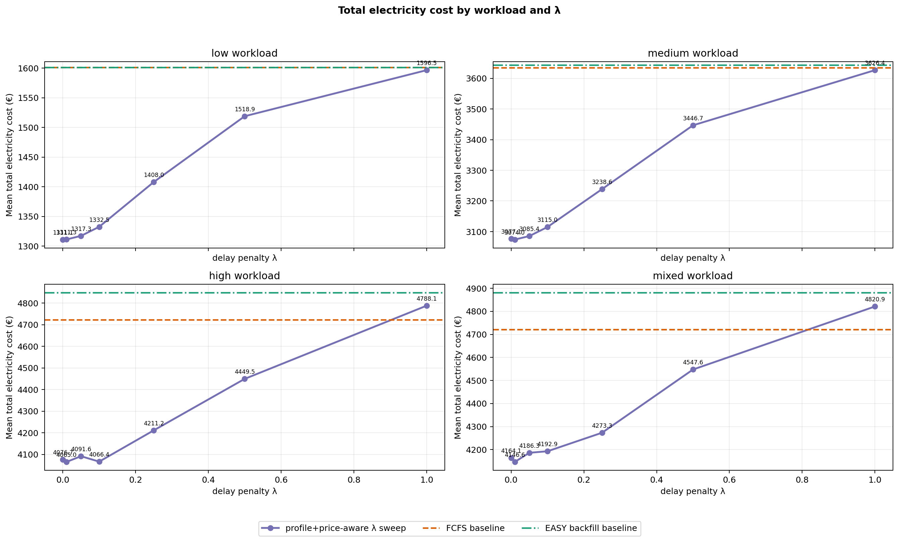
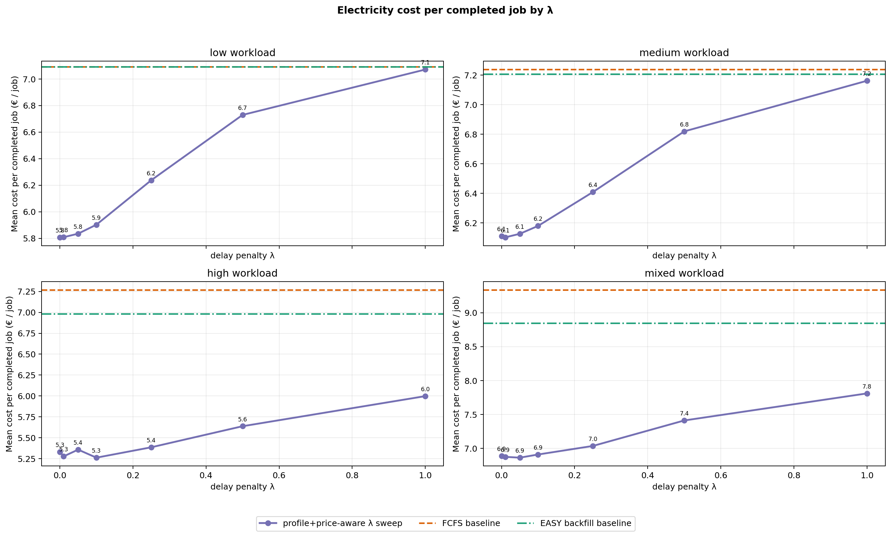
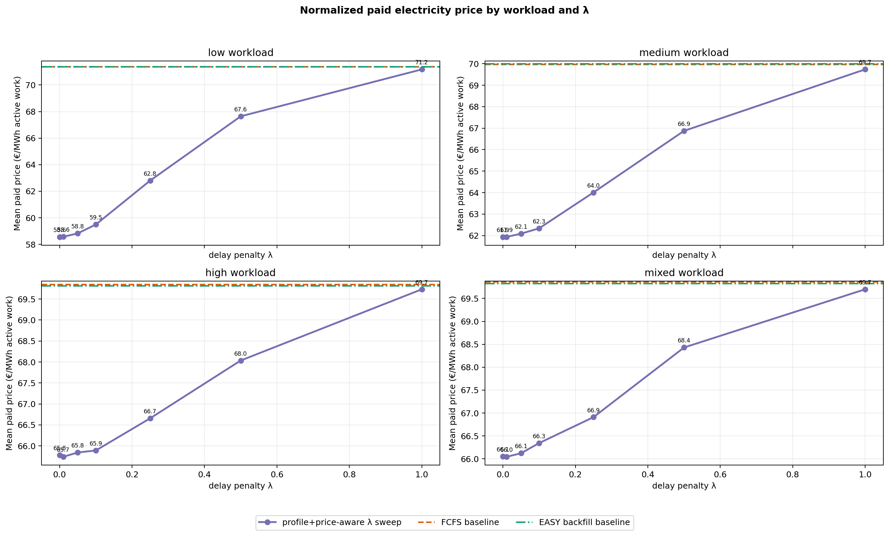
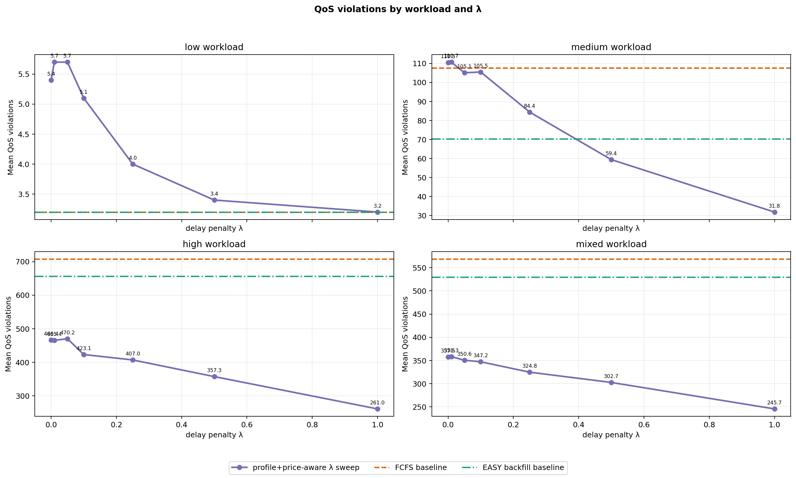
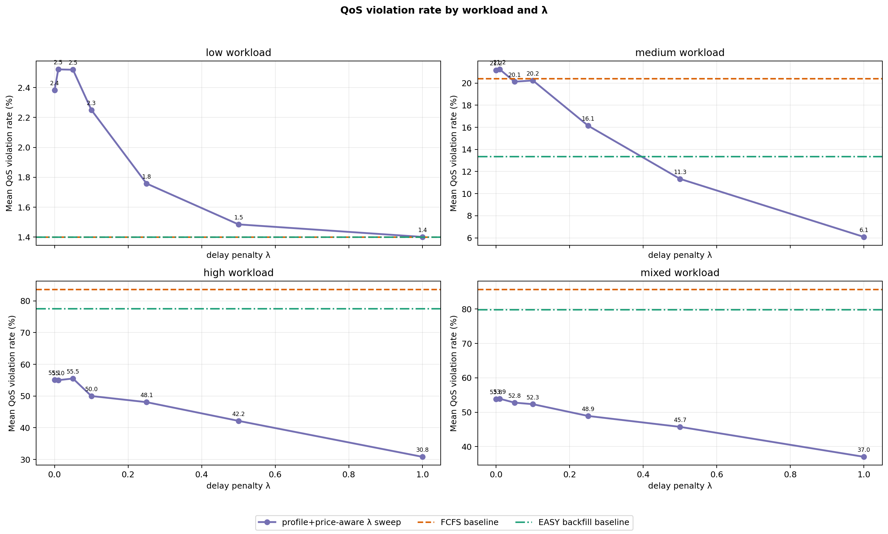
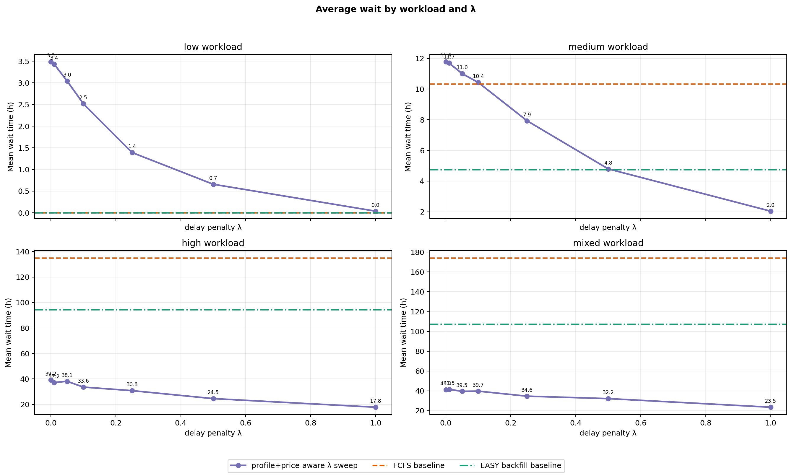
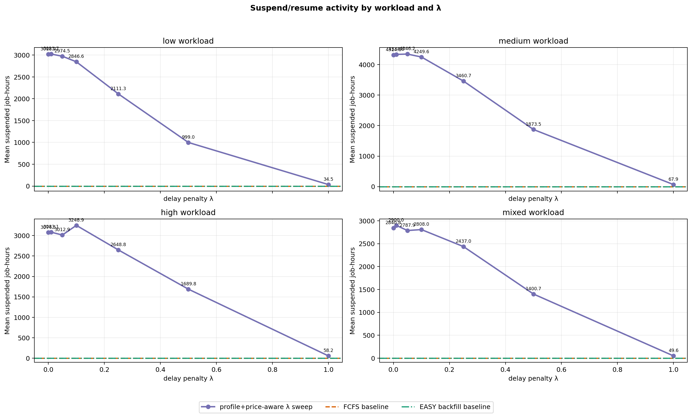

# Current Policy Evaluation — FCFS, EASY Backfilling, and Profile+Price-Aware λ Sweep

This is the current cleaned Bachelor-thesis simulator result artifact. It keeps only the focused scheduler comparison:

1. `fcfs` baseline.
2. `easy_backfill` baseline.
3. `price_aware_preemptive`, the current profile+price-aware pause/resume policy, evaluated over several λ values.

The older non-preemptive delayed-start `price_aware` scheduler model is intentionally not part of this report.

## Run configuration

- price_source: `data/prices/smard_de_lu_2024_hourly.csv`
- price_offset_h: `0`
- arrival/simulation horizon: `1440` h (`60.0` days)
- loaded price horizon: `1440` h
- capacity_nodes: `64`
- power_kw_per_node: `1`
- seeds: `1, 2, 3, 4, 5, 6, 7, 8, 9, 10`
- lambda_values: `0, 0.01, 0.05, 0.1, 0.25, 0.5, 1`
- parallel_workers: `30`
- qos_violation_penalty_eur for λ ranking: `1000`
- maximum generated job duration observed: `336` h

## Workload scale

- Mean jobs per low workload: `230.8`.
- Mean jobs per medium workload: `517.2`.
- Mean jobs per high workload: `845.6`.
- Mean jobs per mixed workload: `663.5`.
- Runtime classes: `short_debug` = 1–6 h, `medium` = 6–48 h, `long` = 48–336 h.

## Current policy model

Jobs reserve their requested node count until completion. The hourly `JobProfile` controls how many of those reserved nodes are active and therefore how much electricity cost is incurred. In the current preemptive policy, checkpointable jobs can be paused/resumed at hourly boundaries, but paused jobs keep their reserved nodes.

The λ parameter is an urgency term in the hourly run/skip decision. Lower λ lets the policy wait more aggressively for cheap hours; higher λ makes it less willing to delay when the expected saving is small.

## Best λ by QoS-penalized objective

- low: λ=`1.0`; cost=1596.4872 €, cost/job=7.0714 €, paid_price=71.176 €/MWh, QoS=3.2, avg_wait=0.037 h, penalized=4796.4872 €.
- medium: λ=`1.0`; cost=3626.4116 €, cost/job=7.1611 €, paid_price=69.7364 €/MWh, QoS=31.8, avg_wait=2.0387 h, penalized=35426.4116 €.
- high: λ=`1.0`; cost=4788.1472 €, cost/job=5.9981 €, paid_price=69.7301 €/MWh, QoS=261.0, avg_wait=17.8162 h, penalized=265788.1472 €.
- mixed: λ=`1.0`; cost=4820.9097 €, cost/job=7.8102 €, paid_price=69.6999 €/MWh, QoS=245.7, avg_wait=23.5068 h, penalized=250520.9097 €.

## Plots

## Summary table

| Load | Variant | λ | Runs | Completed mean | Cost mean € | Cost/job € | QoS mean | QoS rate % | Paid €/MWh | Avg wait h | Reserved util | Suspended h | Penalized € |
|---|---|---:|---:|---:|---:|---:|---:|---:|---:|---:|---:|---:|---:|
| low | fcfs | baseline | 10 | 227.6 | 1601.215 | 7.092 | 3.2 | 1.4012 | 71.3879 | 0.0004 | 0.3129 | 0.0 | 4801.215 |
| low | easy_backfill | baseline | 10 | 227.6 | 1601.215 | 7.092 | 3.2 | 1.4012 | 71.3879 | 0.0004 | 0.3129 | 0.0 | 4801.215 |
| low | preemptive_profile_price_aware_lambda_0 | 0.0 | 10 | 227.6 | 1311.0645 | 5.8073 | 5.4 | 2.3824 | 58.5566 | 3.4838 | 0.4764 | 3018.2 | 6711.0645 |
| low | preemptive_profile_price_aware_lambda_0.01 | 0.01 | 10 | 227.6 | 1311.2511 | 5.8082 | 5.7 | 2.5212 | 58.5648 | 3.4334 | 0.4767 | 3023.7 | 7011.2511 |
| low | preemptive_profile_price_aware_lambda_0.05 | 0.05 | 10 | 227.6 | 1317.2752 | 5.835 | 5.7 | 2.519 | 58.8213 | 3.0421 | 0.4748 | 2974.5 | 7017.2752 |
| low | preemptive_profile_price_aware_lambda_0.1 | 0.1 | 10 | 227.6 | 1332.5414 | 5.9027 | 5.1 | 2.2502 | 59.4899 | 2.517 | 0.4674 | 2846.6 | 6432.5414 |
| low | preemptive_profile_price_aware_lambda_0.25 | 0.25 | 10 | 227.6 | 1408.0085 | 6.2375 | 4.0 | 1.7582 | 62.7996 | 1.3906 | 0.4261 | 2111.3 | 5408.0085 |
| low | preemptive_profile_price_aware_lambda_0.5 | 0.5 | 10 | 227.6 | 1518.9127 | 6.7295 | 3.4 | 1.4849 | 67.6411 | 0.6584 | 0.359 | 999.0 | 4918.9127 |
| low | preemptive_profile_price_aware_lambda_1 | 1.0 | 10 | 227.6 | 1596.4872 | 7.0714 | 3.2 | 1.4012 | 71.176 | 0.037 | 0.3144 | 34.5 | 4796.4872 |
| medium | fcfs | baseline | 10 | 501.9 | 3634.7971 | 7.2372 | 107.6 | 20.423 | 69.9662 | 10.3412 | 0.7176 | 0.0 | 111234.7971 |
| medium | easy_backfill | baseline | 10 | 505.0 | 3643.054 | 7.2071 | 70.3 | 13.3503 | 70.002 | 4.7559 | 0.7188 | 0.0 | 73943.054 |
| medium | preemptive_profile_price_aware_lambda_0 | 0.0 | 10 | 503.1 | 3077.1063 | 6.1098 | 110.5 | 21.1723 | 61.9369 | 11.7726 | 0.8851 | 4314.6 | 113577.1063 |
| medium | preemptive_profile_price_aware_lambda_0.01 | 0.01 | 10 | 503.3 | 3074.0407 | 6.1017 | 110.7 | 21.2396 | 61.9375 | 11.6954 | 0.8861 | 4334.8 | 113774.0407 |
| medium | preemptive_profile_price_aware_lambda_0.05 | 0.05 | 10 | 503.2 | 3085.4239 | 6.1257 | 105.1 | 20.1283 | 62.0871 | 11.0102 | 0.8891 | 4346.2 | 108185.4239 |
| medium | preemptive_profile_price_aware_lambda_0.1 | 0.1 | 10 | 503.6 | 3115.0176 | 6.1791 | 105.5 | 20.2374 | 62.3383 | 10.4272 | 0.8888 | 4249.6 | 108615.0176 |
| medium | preemptive_profile_price_aware_lambda_0.25 | 0.25 | 10 | 504.9 | 3238.6143 | 6.4082 | 84.4 | 16.1484 | 64.0074 | 7.9333 | 0.8627 | 3460.7 | 87638.6143 |
| medium | preemptive_profile_price_aware_lambda_0.5 | 0.5 | 10 | 504.9 | 3446.6928 | 6.8186 | 59.4 | 11.3363 | 66.8743 | 4.7947 | 0.7962 | 1873.5 | 62846.6928 |
| medium | preemptive_profile_price_aware_lambda_1 | 1.0 | 10 | 505.8 | 3626.4116 | 7.1611 | 31.8 | 6.0857 | 69.7364 | 2.0387 | 0.7212 | 67.9 | 35426.4116 |
| high | fcfs | baseline | 10 | 654.0 | 4723.7863 | 7.2693 | 708.0 | 83.6645 | 69.8495 | 135.0188 | 0.9269 | 0.0 | 712723.7863 |
| high | easy_backfill | baseline | 10 | 697.7 | 4849.024 | 6.9827 | 656.8 | 77.6105 | 69.8188 | 94.4288 | 0.9525 | 0.0 | 661649.024 |
| high | preemptive_profile_price_aware_lambda_0 | 0.0 | 10 | 765.6 | 4076.6693 | 5.3316 | 466.4 | 55.0713 | 65.781 | 39.2299 | 0.9612 | 3074.5 | 470476.6693 |
| high | preemptive_profile_price_aware_lambda_0.01 | 0.01 | 10 | 771.2 | 4064.9942 | 5.2772 | 465.4 | 55.0011 | 65.74 | 37.2114 | 0.9617 | 3083.1 | 469464.9942 |
| high | preemptive_profile_price_aware_lambda_0.05 | 0.05 | 10 | 764.6 | 4091.5722 | 5.3584 | 470.2 | 55.5152 | 65.8435 | 38.1391 | 0.9628 | 3012.9 | 474291.5722 |
| high | preemptive_profile_price_aware_lambda_0.1 | 0.1 | 10 | 774.0 | 4066.4238 | 5.2623 | 423.1 | 49.9924 | 65.8909 | 33.5932 | 0.9607 | 3248.9 | 427166.4238 |
| high | preemptive_profile_price_aware_lambda_0.25 | 0.25 | 10 | 782.3 | 4211.1846 | 5.3864 | 407.0 | 48.0592 | 66.6572 | 30.8039 | 0.9592 | 2648.8 | 411211.1846 |
| high | preemptive_profile_price_aware_lambda_0.5 | 0.5 | 10 | 789.5 | 4449.5291 | 5.6384 | 357.3 | 42.1565 | 68.0341 | 24.5488 | 0.9545 | 1689.8 | 361749.5291 |
| high | preemptive_profile_price_aware_lambda_1 | 1.0 | 10 | 798.5 | 4788.1472 | 5.9981 | 261.0 | 30.8155 | 69.7301 | 17.8162 | 0.9437 | 58.2 | 265788.1472 |
| mixed | fcfs | baseline | 10 | 508.4 | 4720.4093 | 9.3376 | 568.7 | 85.7579 | 69.864 | 174.1925 | 0.9278 | 0.0 | 573420.4093 |
| mixed | easy_backfill | baseline | 10 | 554.3 | 4881.3834 | 8.846 | 529.6 | 79.8589 | 69.8292 | 107.4154 | 0.9599 | 0.0 | 534481.3834 |
| mixed | preemptive_profile_price_aware_lambda_0 | 0.0 | 10 | 605.3 | 4164.1093 | 6.8891 | 357.5 | 53.8078 | 66.0547 | 41.1938 | 0.9647 | 2840.8 | 361664.1093 |
| mixed | preemptive_profile_price_aware_lambda_0.01 | 0.01 | 10 | 604.0 | 4146.5587 | 6.8747 | 358.3 | 53.91 | 66.0439 | 41.5313 | 0.9652 | 2900.0 | 362446.5587 |
| mixed | preemptive_profile_price_aware_lambda_0.05 | 0.05 | 10 | 610.5 | 4186.3173 | 6.8626 | 350.6 | 52.7811 | 66.1217 | 39.5255 | 0.9657 | 2787.9 | 354786.3173 |
| mixed | preemptive_profile_price_aware_lambda_0.1 | 0.1 | 10 | 607.6 | 4192.9049 | 6.9093 | 347.2 | 52.3259 | 66.3442 | 39.6961 | 0.9647 | 2808.0 | 351392.9049 |
| mixed | preemptive_profile_price_aware_lambda_0.25 | 0.25 | 10 | 608.3 | 4273.3152 | 7.0355 | 324.8 | 48.9046 | 66.9096 | 34.6254 | 0.9633 | 2437.0 | 329073.3152 |
| mixed | preemptive_profile_price_aware_lambda_0.5 | 0.5 | 10 | 614.3 | 4547.5587 | 7.4112 | 302.7 | 45.7315 | 68.4298 | 32.1665 | 0.9585 | 1400.7 | 307247.5587 |
| mixed | preemptive_profile_price_aware_lambda_1 | 1.0 | 10 | 618.0 | 4820.9097 | 7.8102 | 245.7 | 37.0158 | 69.6999 | 23.5068 | 0.9497 | 49.6 | 250520.9097 |

## Generated files

- `REPORT.md` — this report.
- `RUNS.md` — raw run log in Markdown.
- `runs.csv` — raw per-policy, per-seed, per-load, per-λ results.
- `summary.csv` — mean metrics by workload and policy variant.
- `workloads.csv` — generated workload composition by seed/load.
- `total_cost_by_load.png`, `cost_per_job_by_load.png`, `normalized_price_by_load.png`, `qos_violations_by_load.png`, `qos_violation_rate_percent_by_load.png`, `wait_by_load.png`, `suspension_by_load.png`, `synthetic_profile_examples.png`.
