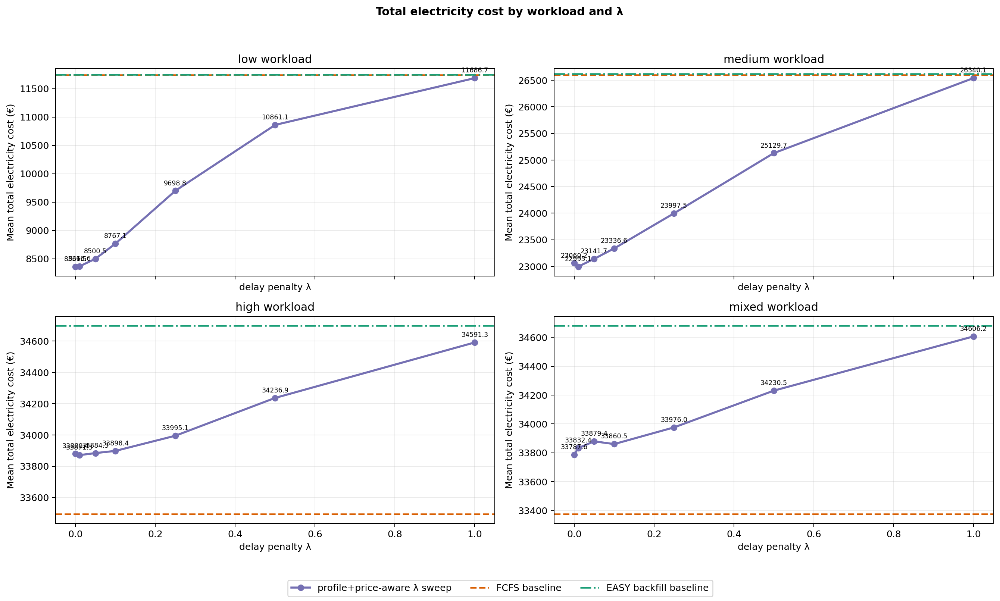
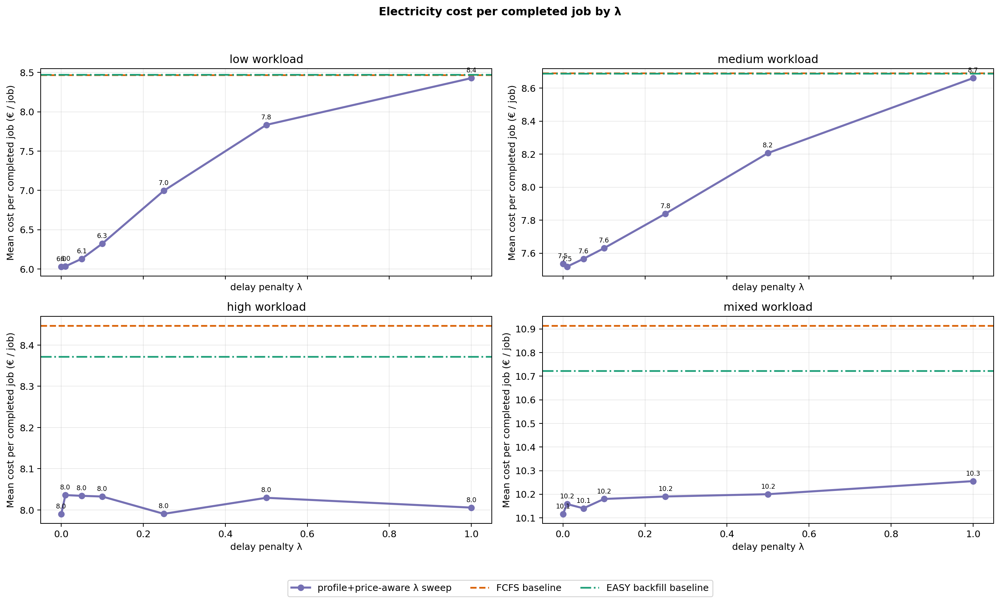
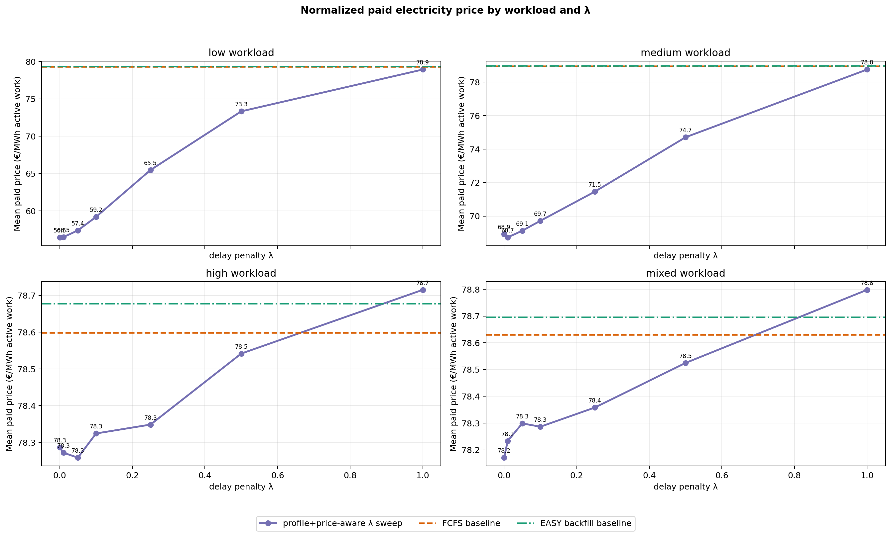
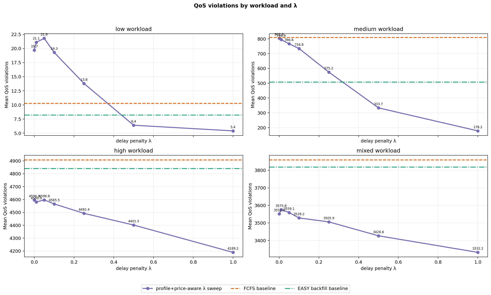
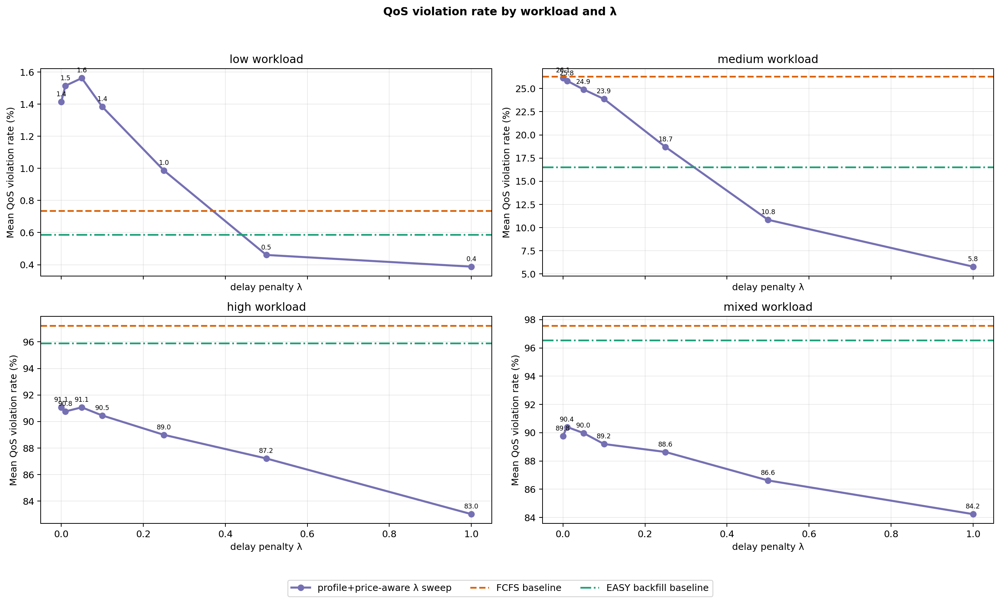
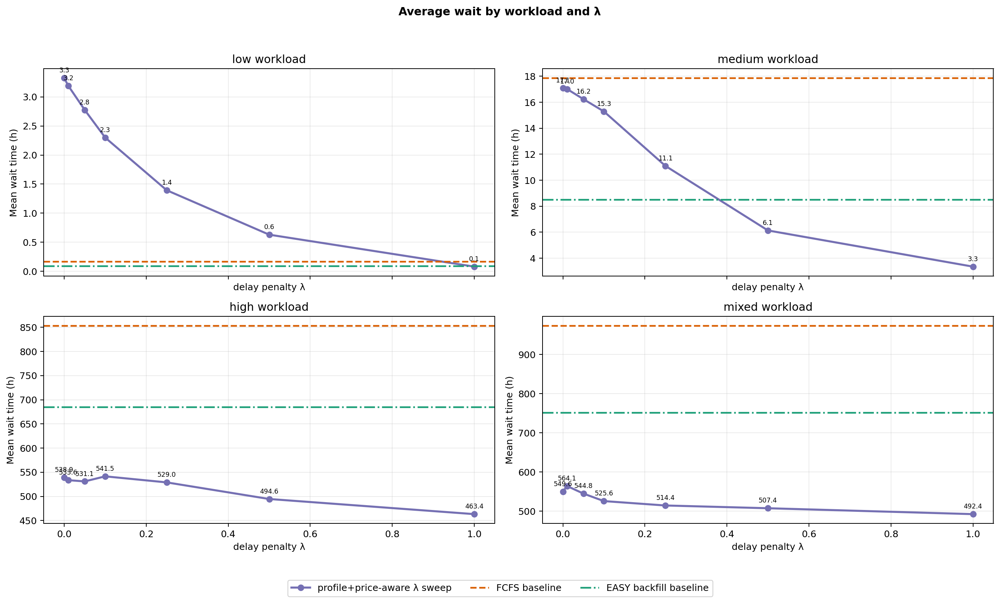
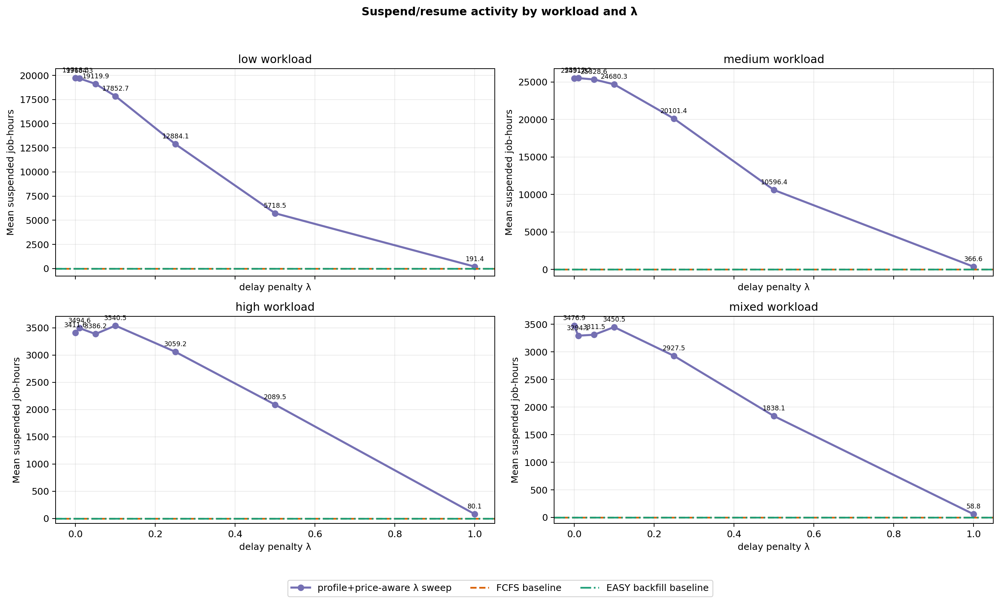

# Current Policy Evaluation — FCFS, EASY Backfilling, and Profile+Price-Aware λ Sweep

This is the current cleaned Bachelor-thesis simulator result artifact. It keeps only the focused scheduler comparison:

1. `fcfs` baseline.
2. `easy_backfill` baseline.
3. `price_aware_preemptive`, the current profile+price-aware pause/resume policy, evaluated over several λ values.

The older non-preemptive delayed-start `price_aware` scheduler model is intentionally not part of this report.

## Run configuration

- price_source: `data/prices/smard_de_lu_2024_hourly.csv`
- price_offset_h: `0`
- arrival/simulation horizon: `8784` h (`366.0` days)
- loaded price horizon: `8784` h
- capacity_nodes: `64`
- power_kw_per_node: `1`
- seeds: `1, 2, 3, 4, 5, 6, 7, 8, 9, 10`
- lambda_values: `0, 0.01, 0.05, 0.1, 0.25, 0.5, 1`
- parallel_workers: `30`
- qos_violation_penalty_eur for λ ranking: `1000`
- maximum generated job duration observed: `336` h

## Workload scale

- Mean jobs per low workload: `1391.6`.
- Mean jobs per medium workload: `3073.1`.
- Mean jobs per high workload: `5047.8`.
- Mean jobs per mixed workload: `3955.4`.
- Runtime classes: `short_debug` = 1–6 h, `medium` = 6–48 h, `long` = 48–336 h.

## Current policy model

Jobs reserve their requested node count until completion. The hourly `JobProfile` controls how many of those reserved nodes are active and therefore how much electricity cost is incurred. In the current preemptive policy, checkpointable jobs can be paused/resumed at hourly boundaries, but paused jobs keep their reserved nodes.

The λ parameter is an urgency term in the hourly run/skip decision. Lower λ lets the policy wait more aggressively for cheap hours; higher λ makes it less willing to delay when the expected saving is small.

## Best λ by QoS-penalized objective

- low: λ=`1.0`; cost=11686.7012 €, cost/job=8.4286 €, paid_price=78.9361 €/MWh, QoS=5.4, avg_wait=0.0788 h, penalized=17086.7012 €.
- medium: λ=`1.0`; cost=26540.0982 €, cost/job=8.661 €, paid_price=78.755 €/MWh, QoS=178.2, avg_wait=3.3476 h, penalized=204740.0982 €.
- high: λ=`1.0`; cost=34591.2681 €, cost/job=8.0057 €, paid_price=78.7154 €/MWh, QoS=4189.2, avg_wait=463.3531 h, penalized=4223791.2681 €.
- mixed: λ=`1.0`; cost=34606.1858 €, cost/job=10.2556 €, paid_price=78.798 €/MWh, QoS=3332.2, avg_wait=492.3546 h, penalized=3366806.1858 €.

## Plots

## Summary table

| Load | Variant | λ | Runs | Completed mean | Cost mean € | Cost/job € | QoS mean | QoS rate % | Paid €/MWh | Avg wait h | Reserved util | Suspended h | Penalized € |
|---|---|---:|---:|---:|---:|---:|---:|---:|---:|---:|---:|---:|---:|
| low | fcfs | baseline | 10 | 1386.8 | 11744.7926 | 8.4706 | 10.3 | 0.7356 | 79.3302 | 0.1649 | 0.3339 | 0.0 | 22044.7926 |
| low | easy_backfill | baseline | 10 | 1386.8 | 11745.4358 | 8.4711 | 8.2 | 0.5865 | 79.3345 | 0.0929 | 0.3339 | 0.0 | 19945.4358 |
| low | preemptive_profile_price_aware_lambda_0 | 0.0 | 10 | 1386.6 | 8361.5107 | 6.0312 | 19.7 | 1.4138 | 56.4554 | 3.3238 | 0.5131 | 19718.3 | 28061.5107 |
| low | preemptive_profile_price_aware_lambda_0.01 | 0.01 | 10 | 1386.6 | 8366.5615 | 6.0349 | 21.1 | 1.5142 | 56.4888 | 3.1913 | 0.5128 | 19684.3 | 29466.5615 |
| low | preemptive_profile_price_aware_lambda_0.05 | 0.05 | 10 | 1386.6 | 8500.468 | 6.1315 | 21.8 | 1.562 | 57.3916 | 2.7761 | 0.5077 | 19119.9 | 30300.468 |
| low | preemptive_profile_price_aware_lambda_0.1 | 0.1 | 10 | 1386.6 | 8767.1428 | 6.324 | 19.3 | 1.3834 | 59.1938 | 2.2994 | 0.4955 | 17852.7 | 28067.1428 |
| low | preemptive_profile_price_aware_lambda_0.25 | 0.25 | 10 | 1386.6 | 9698.8435 | 6.9961 | 13.8 | 0.9873 | 65.4751 | 1.3935 | 0.4459 | 12884.1 | 23498.8435 |
| low | preemptive_profile_price_aware_lambda_0.5 | 0.5 | 10 | 1386.7 | 10861.0521 | 7.8339 | 6.4 | 0.4606 | 73.3347 | 0.6288 | 0.3767 | 5718.5 | 17261.0521 |
| low | preemptive_profile_price_aware_lambda_1 | 1.0 | 10 | 1386.8 | 11686.7012 | 8.4286 | 5.4 | 0.3879 | 78.9361 | 0.0788 | 0.3352 | 191.4 | 17086.7012 |
| medium | fcfs | baseline | 10 | 3061.3 | 26600.0789 | 8.6906 | 810.0 | 26.3126 | 78.9588 | 17.8576 | 0.7605 | 0.0 | 836600.0789 |
| medium | easy_backfill | baseline | 10 | 3064.6 | 26622.3865 | 8.6884 | 508.4 | 16.51 | 78.9766 | 8.5152 | 0.7611 | 0.0 | 535022.3865 |
| medium | preemptive_profile_price_aware_lambda_0 | 0.0 | 10 | 3060.1 | 23060.1686 | 7.5361 | 803.6 | 26.1257 | 68.9166 | 17.0861 | 0.9339 | 25491.3 | 826660.1686 |
| medium | preemptive_profile_price_aware_lambda_0.01 | 0.01 | 10 | 3058.5 | 22995.1116 | 7.5186 | 794.9 | 25.8376 | 68.7299 | 17.0196 | 0.9343 | 25512.2 | 817895.1116 |
| medium | preemptive_profile_price_aware_lambda_0.05 | 0.05 | 10 | 3058.9 | 23141.7479 | 7.566 | 766.6 | 24.9065 | 69.1266 | 16.2391 | 0.9345 | 25328.6 | 789741.7479 |
| medium | preemptive_profile_price_aware_lambda_0.1 | 0.1 | 10 | 3058.7 | 23336.5935 | 7.6302 | 734.8 | 23.876 | 69.7177 | 15.2905 | 0.9312 | 24680.3 | 758136.5935 |
| medium | preemptive_profile_price_aware_lambda_0.25 | 0.25 | 10 | 3061.3 | 23997.5013 | 7.8396 | 575.2 | 18.6987 | 71.4604 | 11.0987 | 0.9042 | 20101.4 | 599197.5012 |
| medium | preemptive_profile_price_aware_lambda_0.5 | 0.5 | 10 | 3062.3 | 25129.735 | 8.207 | 333.7 | 10.8436 | 74.7101 | 6.1321 | 0.8312 | 10596.4 | 358829.735 |
| medium | preemptive_profile_price_aware_lambda_1 | 1.0 | 10 | 3064.8 | 26540.0982 | 8.661 | 178.2 | 5.79 | 78.755 | 3.3476 | 0.7631 | 366.6 | 204740.0982 |
| high | fcfs | baseline | 10 | 3977.7 | 33494.2637 | 8.4472 | 4908.2 | 97.2263 | 78.5984 | 853.3934 | 0.959 | 0.0 | 4941694.2637 |
| high | easy_backfill | baseline | 10 | 4156.4 | 34698.879 | 8.3719 | 4841.3 | 95.9086 | 78.678 | 685.1487 | 0.9921 | 0.0 | 4875998.879 |
| high | preemptive_profile_price_aware_lambda_0 | 0.0 | 10 | 4250.6 | 33880.3519 | 7.9899 | 4596.9 | 91.0684 | 78.2861 | 538.8603 | 0.9935 | 3411.6 | 4630780.3519 |
| high | preemptive_profile_price_aware_lambda_0.01 | 0.01 | 10 | 4224.9 | 33871.3217 | 8.0361 | 4580.9 | 90.7587 | 78.2718 | 533.5913 | 0.9935 | 3494.6 | 4614771.3217 |
| high | preemptive_profile_price_aware_lambda_0.05 | 0.05 | 10 | 4230.4 | 33884.2693 | 8.0343 | 4596.8 | 91.0665 | 78.2583 | 531.0669 | 0.9938 | 3386.2 | 4630684.2693 |
| high | preemptive_profile_price_aware_lambda_0.1 | 0.1 | 10 | 4229.7 | 33898.3811 | 8.0326 | 4565.5 | 90.4528 | 78.3242 | 541.5229 | 0.9934 | 3540.5 | 4599398.3811 |
| high | preemptive_profile_price_aware_lambda_0.25 | 0.25 | 10 | 4263.0 | 33995.0729 | 7.9906 | 4492.4 | 88.9968 | 78.3484 | 529.0037 | 0.993 | 3059.2 | 4526395.0729 |
| high | preemptive_profile_price_aware_lambda_0.5 | 0.5 | 10 | 4272.7 | 34236.8554 | 8.0295 | 4401.5 | 87.2138 | 78.5418 | 494.6439 | 0.9921 | 2089.5 | 4435736.8554 |
| high | preemptive_profile_price_aware_lambda_1 | 1.0 | 10 | 4331.4 | 34591.2681 | 8.0057 | 4189.2 | 83.0196 | 78.7154 | 463.3531 | 0.9899 | 80.1 | 4223791.2681 |
| mixed | fcfs | baseline | 10 | 3061.4 | 33375.1789 | 10.914 | 3859.5 | 97.577 | 78.6303 | 973.4272 | 0.9569 | 0.0 | 3892875.1789 |
| mixed | easy_backfill | baseline | 10 | 3237.8 | 34681.1566 | 10.7233 | 3818.8 | 96.547 | 78.696 | 751.858 | 0.9934 | 0.0 | 3853481.1566 |
| mixed | preemptive_profile_price_aware_lambda_0 | 0.0 | 10 | 3344.1 | 33787.5963 | 10.1159 | 3551.0 | 89.7662 | 78.1708 | 549.6016 | 0.9937 | 3476.9 | 3584787.5963 |
| mixed | preemptive_profile_price_aware_lambda_0.01 | 0.01 | 10 | 3335.4 | 33832.4463 | 10.1585 | 3575.8 | 90.4031 | 78.2333 | 564.1291 | 0.994 | 3294.1 | 3609632.4463 |
| mixed | preemptive_profile_price_aware_lambda_0.05 | 0.05 | 10 | 3344.2 | 33879.3731 | 10.1405 | 3559.1 | 89.9751 | 78.2988 | 544.7821 | 0.994 | 3311.5 | 3592979.3731 |
| mixed | preemptive_profile_price_aware_lambda_0.1 | 0.1 | 10 | 3329.8 | 33860.4676 | 10.1801 | 3528.2 | 89.1972 | 78.2865 | 525.6145 | 0.9937 | 3450.5 | 3562060.4677 |
| mixed | preemptive_profile_price_aware_lambda_0.25 | 0.25 | 10 | 3337.1 | 33976.0079 | 10.1906 | 3505.9 | 88.634 | 78.3582 | 514.4035 | 0.9936 | 2927.5 | 3539876.0079 |
| mixed | preemptive_profile_price_aware_lambda_0.5 | 0.5 | 10 | 3359.9 | 34230.5399 | 10.2003 | 3426.6 | 86.6205 | 78.5249 | 507.3836 | 0.9926 | 1838.1 | 3460830.5399 |
| mixed | preemptive_profile_price_aware_lambda_1 | 1.0 | 10 | 3381.0 | 34606.1858 | 10.2556 | 3332.2 | 84.236 | 78.798 | 492.3546 | 0.991 | 58.8 | 3366806.1858 |

## Generated files

- `REPORT.md` — this report.
- `RUNS.md` — raw run log in Markdown.
- `runs.csv` — raw per-policy, per-seed, per-load, per-λ results.
- `summary.csv` — mean metrics by workload and policy variant.
- `workloads.csv` — generated workload composition by seed/load.
- `total_cost_by_load.png`, `cost_per_job_by_load.png`, `normalized_price_by_load.png`, `qos_violations_by_load.png`, `qos_violation_rate_percent_by_load.png`, `wait_by_load.png`, `suspension_by_load.png`, `synthetic_profile_examples.png`.
